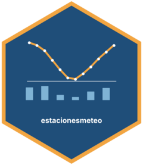

<!-- README.md is generated from README.Rmd. Please edit that file -->

```{r, include = FALSE}
knitr::opts_chunk$set(
  collapse = TRUE,
  comment = "#>",
  fig.path = "man/figures/README-",
  out.width = "100%"
)
```

# estacionesmeteo 

<!-- badges: start -->
<!-- badges: end -->

¡Hola! Te damos la bienvenida a **estacionesmeteo**, un paquete de R para leer, resumir y graficar datos de estaciones meteorológicas del INTA.

> Este es un paquete de prueba, desarrollado para la materia Programación II de la Licenciatura en Ciencia de Datos. No está pensado para usarse como un paquete real.

## ¿Para qué sirve?

El INTA registra todos los días la temperatura, la lluvia y la humedad en estaciones meteorológicas de todo el país. Trabajar con esos datos implica descargar archivos, leerlos con los tipos de columna correctos y repetir los mismos cálculos para cada estación.

estacionesmeteo junta esos pasos en tres funciones, para que cualquier persona que trabaje con datos del clima, aunque recién empiece con R, pueda ir de los datos crudos a una tabla y un gráfico en pocas líneas:

| Función | Qué hace |
|---|---|
| `leer_estacion()` | Descarga los datos de una estación, solo si todavía no están descargados, y los lee |
| `tabla_resumen_temperatura()` | Calcula la media y el desvío estándar de la temperatura de cada estación |
| `grafico_temperatura_mensual()` | Grafica el promedio de temperatura de cada mes, con una línea por estación |

Además, incluye el dataset `estaciones`, con mediciones diarias de cinco estaciones: NH0472, NH0910, NH0046, NH0098 y NH0437.

## Instalación

Podés instalar el paquete desde GitHub con:

``` r
# install.packages("pak")
pak::pak("Dolorespalavecino/estacionesmeteo")
```

## Ejemplo de uso

```{r ejemplo}
library(estacionesmeteo)
```

Leer los datos de una estación (necesita conexión a internet):

```{r, eval = FALSE}
NH0437 <- leer_estacion("NH0437", "datos/NH0437.csv")
```

Resumir la temperatura de las cinco estaciones incluidas:

```{r resumen}
tabla_resumen_temperatura(estaciones)
```

Graficar el promedio mensual:

```{r grafico}
grafico_temperatura_mensual(
  estaciones,
  colores = c("red", "blue", "darkgreen", "orange", "purple"),
  titulo = "Temperatura media mensual"
)
```

Para un análisis más completo, mirá la viñeta con `vignette("estacionesmeteo", package = "estacionesmeteo")`.

## Autores

- Dolores Palavecino ([@Dolorespalavecino](https://github.com/Dolorespalavecino))
- Alejo Settimini ([@Alej035](https://github.com/Alej035))

