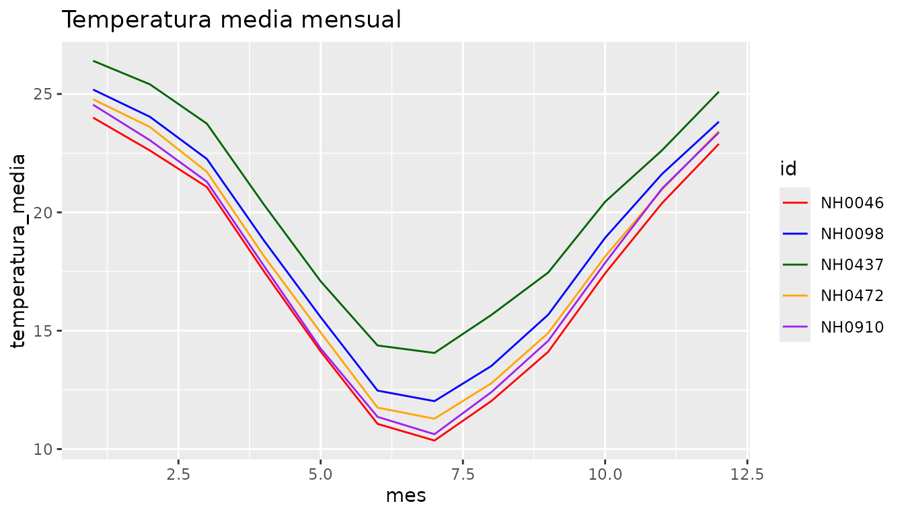
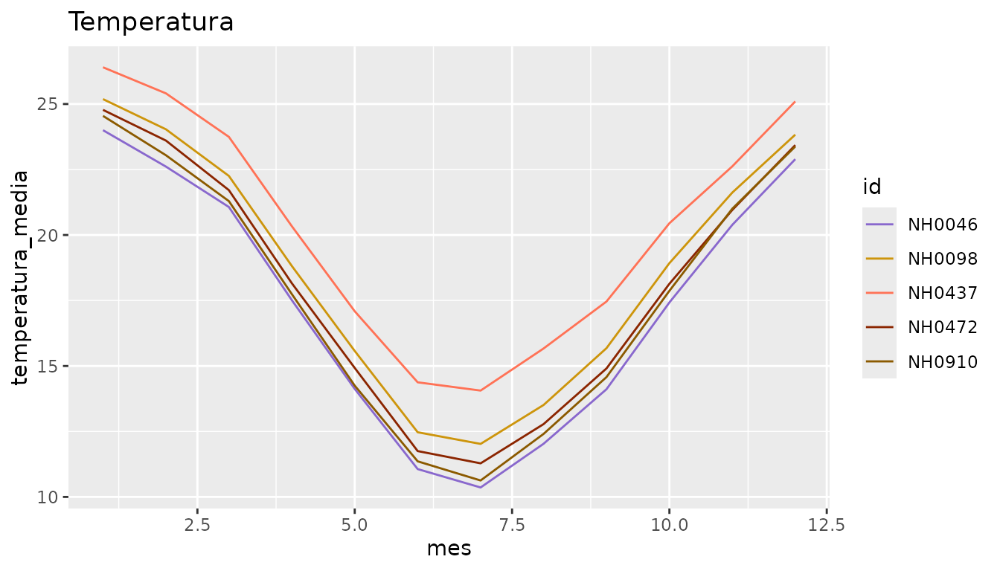
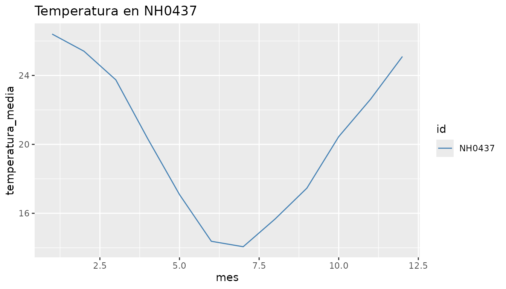
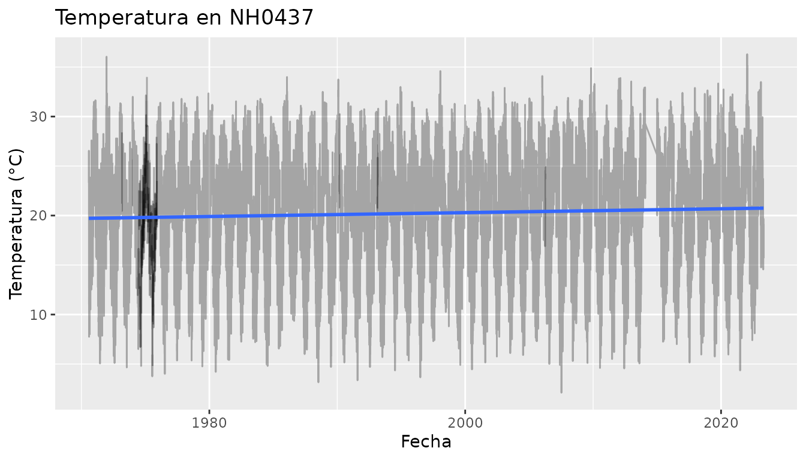
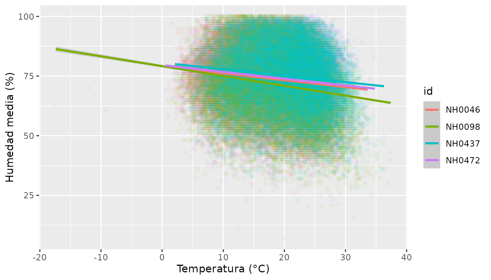
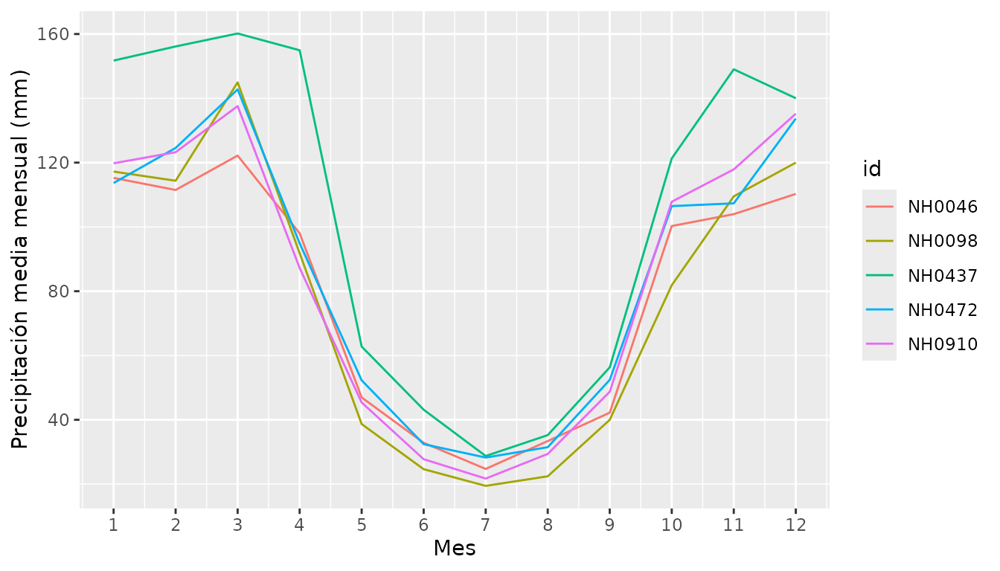

# Cómo usar estacionesmeteo

``` r

library(estacionesmeteo)
```

## ¿Qué hace este paquete?

estacionesmeteo permite leer, resumir y graficar datos diarios de
estaciones meteorológicas del INTA. Los datos vienen del sistema SIGA
del INTA y están disponibles en el repositorio de la materia
Programación II.

Esta guía muestra un análisis de punta a punta con las tres funciones
del paquete.

## Los datos incluidos

El paquete trae el dataset `estaciones`, con mediciones diarias de cinco
estaciones.

``` r

head(estaciones)
#>       id      fecha temperatura_abrigo_150cm temperatura_abrigo_150cm_maxima
#> 1 NH0472 1961-07-01                     11.1                            13.4
#> 2 NH0472 1961-07-02                      5.5                            10.5
#> 3 NH0472 1961-07-03                      6.0                            10.8
#> 4 NH0472 1961-07-04                       NA                              NA
#> 5 NH0472 1961-07-05                     12.4                            14.8
#> 6 NH0472 1961-07-06                     11.0                            16.5
#>   temperatura_abrigo_150cm_minima precipitacion_pluviometrica
#> 1                             8.8                           0
#> 2                             0.5                           0
#> 3                             1.2                           0
#> 4                             7.0                           0
#> 5                            10.0                           0
#> 6                             5.5                           0
#>   humedad_media_8_14_20
#> 1                    81
#> 2                    80
#> 3                    62
#> 4                    93
#> 5                    92
#> 6                    80
unique(estaciones$id)
#> [1] "NH0472" "NH0910" "NH0046" "NH0098" "NH0437"
```

Cada fila es un día en una estación. La columna `id` identifica la
estación y `temperatura_abrigo_150cm` es la temperatura media de abrigo
a 150 cm, en grados Celsius. Con
[`?estaciones`](https://dolorespalavecino.github.io/estacionesmeteo/reference/estaciones.md)
se puede ver la descripción de todas las columnas.

## Leer los datos de otra estación

[`leer_estacion()`](https://dolorespalavecino.github.io/estacionesmeteo/reference/leer_estacion.md)
descarga los datos de cualquier estación del repositorio y los lee. Si
el archivo ya está descargado, lo lee sin volver a descargarlo.

``` r

NH0437 <- leer_estacion("NH0437", "datos/NH0437.csv")
```

Este bloque no se ejecuta en la guía porque necesita conexión a
internet.

Si el código de la estación no es texto, la función da un error claro:

``` r

leer_estacion(437, "datos/NH0437.csv")
#> Error in `leer_estacion()`:
#> ! id_estacion debe ser texto.
#> ℹ La variable ingresada es un numeric.
```

## Resumir la temperatura

[`tabla_resumen_temperatura()`](https://dolorespalavecino.github.io/estacionesmeteo/reference/tabla_resumen_temperatura.md)
calcula la media y el desvío estándar de la temperatura de abrigo de
cada estación.

``` r

tabla_resumen_temperatura(estaciones)
#> # A tibble: 2 × 6
#>   variable NH0046 NH0098 NH0437 NH0472 NH0910
#>   <chr>     <dbl>  <dbl>  <dbl>  <dbl>  <dbl>
#> 1 media     17.3   18.6   20.2   18.0   17.7 
#> 2 desvio     5.90   5.98   5.77   5.94   6.12
```

NH0437 es la estación más cálida, con una media de alrededor de 20 °C.
Las demás tienen medias de entre 17 y 19 °C. El desvío es parecido en
todas, de alrededor de 6 °C.

## Graficar la temperatura mensual

[`grafico_temperatura_mensual()`](https://dolorespalavecino.github.io/estacionesmeteo/reference/grafico_temperatura_mensual.md)
grafica el promedio de temperatura de cada mes, con una línea por
estación.

``` r

grafico_temperatura_mensual(
  estaciones,
  colores = c("red", "blue", "darkgreen", "orange", "purple"),
  titulo = "Temperatura media mensual"
)
```



Las cinco estaciones siguen el mismo ciclo anual: los meses más cálidos
son de diciembre a febrero y los más fríos, junio y julio. NH0437 es la
más cálida en todos los meses.

Si no se indican colores, la función los elige al azar:

``` r

grafico_temperatura_mensual(estaciones)
```



También se puede graficar una sola estación:

``` r

NH0437 <- estaciones[estaciones$id == "NH0437", ]
grafico_temperatura_mensual(NH0437, colores = "steelblue", titulo = "Temperatura en NH0437")
```

 \## Un
análisis más completo

Además de las funciones del paquete, los datos de `estaciones` se pueden
analizar con dplyr y ggplot2. Esta sección muestra algunos ejemplos.

### ¿Qué período cubre cada estación?

``` r

estaciones |>
  dplyr::group_by(id) |>
  dplyr::summarise(desde = min(fecha), hasta = max(fecha), dias = dplyr::n())
#> # A tibble: 5 × 4
#>   id     desde      hasta       dias
#>   <chr>  <date>     <date>     <int>
#> 1 NH0046 1973-01-01 2023-03-31 17041
#> 2 NH0098 1956-04-01 2023-04-27 23733
#> 3 NH0437 1970-08-01 2023-04-27 18929
#> 4 NH0472 1961-07-01 2017-06-01 20425
#> 5 NH0910 1975-01-01 2017-07-31 15553
```

Las estaciones no cubren el mismo período: NH0098 empieza en 1956 y
NH0910 en 1975. NH0472 y NH0910 terminan en 2017, y las demás en 2023.
Conviene tenerlo en cuenta al compararlas.

### ¿Cuántos datos faltan?

``` r

estaciones |>
  dplyr::group_by(id) |>
  dplyr::summarise(porcentaje_na = round(mean(is.na(temperatura_abrigo_150cm)) * 100, 2))
#> # A tibble: 5 × 2
#>   id     porcentaje_na
#>   <chr>          <dbl>
#> 1 NH0046          1.52
#> 2 NH0098          0.81
#> 3 NH0437          1.01
#> 4 NH0472          0.32
#> 5 NH0910          0.3
```

En todas las estaciones falta menos del 2 % de los datos de temperatura,
así que los promedios son confiables.

### Valores sospechosos

``` r

estaciones |>
  dplyr::group_by(id) |>
  dplyr::summarise(minima = min(temperatura_abrigo_150cm, na.rm = TRUE),
                   maxima = max(temperatura_abrigo_150cm, na.rm = TRUE))
#> # A tibble: 5 × 3
#>   id     minima maxima
#>   <chr>   <dbl>  <dbl>
#> 1 NH0046  -0.25   34.6
#> 2 NH0098 -17.4    37.4
#> 3 NH0437   2.1    36.3
#> 4 NH0472   0.55   34.8
#> 5 NH0910   0      35.2
```

La mínima de NH0098, de -17.4 °C, es mucho más baja que la del resto,
que no baja de -0.25 °C. Podría ser un error de medición y conviene
revisarla antes de usar esos datos.

### ¿Cambió la temperatura con los años?

``` r

estaciones |>
  dplyr::filter(id == "NH0437") |>
  ggplot2::ggplot(ggplot2::aes(x = fecha, y = temperatura_abrigo_150cm)) +
  ggplot2::geom_line(alpha = 0.3) +
  ggplot2::geom_smooth(method = "lm") +
  ggplot2::labs(title = "Temperatura en NH0437", x = "Fecha", y = "Temperatura (°C)")
```



En NH0437 la recta de regresión sube unos 0.2 °C por década: la
temperatura media aumentó alrededor de 1 °C entre 1970 y 2023. Es un
cambio chico frente a la diferencia entre verano e invierno, pero la
temperatura no se mantuvo constante.

### Temperatura y humedad

``` r

estaciones |>
  dplyr::filter(!is.na(humedad_media_8_14_20)) |>
  ggplot2::ggplot(ggplot2::aes(x = temperatura_abrigo_150cm, y = humedad_media_8_14_20, color = id)) +
  ggplot2::geom_point(alpha = 0.05) +
  ggplot2::geom_smooth(method = "lm") +
  ggplot2::labs(x = "Temperatura (°C)", y = "Humedad media (%)")
```



La relación es débil y negativa: en los días más cálidos, la humedad
tiende a ser un poco menor, pero los puntos están muy dispersos. NH0910
no aparece porque no tiene datos de humedad.

### Precipitación a lo largo del año

``` r

estaciones |>
  dplyr::mutate(anio = lubridate::year(fecha), mes = lubridate::month(fecha)) |>
  dplyr::group_by(id, anio, mes) |>
  dplyr::summarise(lluvia = sum(precipitacion_pluviometrica, na.rm = TRUE), .groups = "drop") |>
  dplyr::group_by(id, mes) |>
  dplyr::summarise(lluvia_media = mean(lluvia), .groups = "drop") |>
  ggplot2::ggplot(ggplot2::aes(x = mes, y = lluvia_media, color = id)) +
  ggplot2::geom_line() +
  ggplot2::scale_x_continuous(breaks = 1:12) +
  ggplot2::labs(x = "Mes", y = "Precipitación media mensual (mm)")
```



En todas las estaciones llueve más entre octubre y abril, y el invierno
es seco: en julio caen entre 20 y 30 mm. NH0437 es la más lluviosa, con
unos 1230 mm por año, mientras que las demás reciben entre 890 y 980 mm.

## Resumen: analizar una estación nueva

Con las tres funciones, el análisis completo de cualquier estación del
repositorio lleva tres líneas:

``` r

nueva <- leer_estacion("NH0472", "datos/NH0472.csv")
tabla_resumen_temperatura(nueva)
grafico_temperatura_mensual(nueva, titulo = "Temperatura en NH0472")
```
