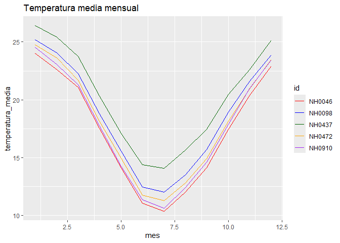

# estacionesmeteo

¡Hola! Te damos la bienvenida a **estacionesmeteo**, un paquete de R
para leer, resumir y graficar datos de estaciones meteorológicas del
INTA.

> Este es un paquete de prueba, desarrollado para la materia
> Programación II de la Licenciatura en Ciencia de Datos. No está
> pensado para usarse como un paquete real.

## ¿Para qué sirve?

El INTA registra todos los días la temperatura, la lluvia y la humedad
en estaciones meteorológicas de todo el país. Trabajar con esos datos
implica descargar archivos, leerlos con los tipos de columna correctos y
repetir los mismos cálculos para cada estación.

estacionesmeteo junta esos pasos en tres funciones, para que cualquier
persona que trabaje con datos del clima, aunque recién empiece con R,
pueda ir de los datos crudos a una tabla y un gráfico en pocas líneas:

| Función | Qué hace |
|----|----|
| [`leer_estacion()`](https://dolorespalavecino.github.io/estacionesmeteo/reference/leer_estacion.md) | Descarga los datos de una estación, solo si todavía no están descargados, y los lee |
| [`tabla_resumen_temperatura()`](https://dolorespalavecino.github.io/estacionesmeteo/reference/tabla_resumen_temperatura.md) | Calcula la media y el desvío estándar de la temperatura de cada estación |
| [`grafico_temperatura_mensual()`](https://dolorespalavecino.github.io/estacionesmeteo/reference/grafico_temperatura_mensual.md) | Grafica el promedio de temperatura de cada mes, con una línea por estación |

Además, incluye el dataset `estaciones`, con mediciones diarias de cinco
estaciones: NH0472, NH0910, NH0046, NH0098 y NH0437.

## Instalación

Podés instalar el paquete desde GitHub con:

``` r

# install.packages("pak")
pak::pak("Dolorespalavecino/estacionesmeteo")
```

## Ejemplo de uso

``` r

library(estacionesmeteo)
```

Leer los datos de una estación (necesita conexión a internet):

``` r

NH0437 <- leer_estacion("NH0437", "datos/NH0437.csv")
```

Resumir la temperatura de las cinco estaciones incluidas:

``` r

tabla_resumen_temperatura(estaciones)
#> # A tibble: 2 × 6
#>   variable NH0046 NH0098 NH0437 NH0472 NH0910
#>   <chr>     <dbl>  <dbl>  <dbl>  <dbl>  <dbl>
#> 1 media     17.3   18.6   20.2   18.0   17.7 
#> 2 desvio     5.90   5.98   5.77   5.94   6.12
```

Graficar el promedio mensual:

``` r

grafico_temperatura_mensual(
  estaciones,
  colores = c("red", "blue", "darkgreen", "orange", "purple"),
  titulo = "Temperatura media mensual"
)
```



Para un análisis más completo, mirá la viñeta con
[`vignette("estacionesmeteo", package = "estacionesmeteo")`](https://dolorespalavecino.github.io/estacionesmeteo/articles/estacionesmeteo.md).

## Autores

- Dolores Palavecino
  ([@Dolorespalavecino](https://github.com/Dolorespalavecino))
- Alejo Settimini ([@Alej035](https://github.com/Alej035))
